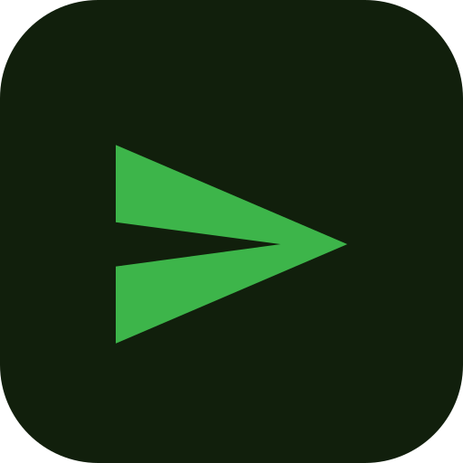

# Augusto Bastos

**Applied AI Developer · Agentic AI · MCP · RAG**

Limerick, Ireland · [Portfolio](https://augbastos.dev) · [LinkedIn](https://www.linkedin.com/in/augustobastos) · [CV](https://augbastos.dev/cv) · [augustobastos@luckycat.ie](mailto:augustobastos@luckycat.ie)

<!-- devcard:start -->

<picture><source media="(prefers-color-scheme: dark)" srcset="https://raw.githubusercontent.com/augbastos/augbastos/devcard-data/lang/body-dark.svg"></picture><picture><source media="(prefers-color-scheme: dark)" srcset="https://raw.githubusercontent.com/augbastos/augbastos/devcard-data/lang/cap-left-dark.svg"></picture><picture><source media="(prefers-color-scheme: dark)" srcset="https://raw.githubusercontent.com/augbastos/augbastos/devcard-data/lang/0-dark.svg"></picture><picture><source media="(prefers-color-scheme: dark)" srcset="https://raw.githubusercontent.com/augbastos/augbastos/devcard-data/lang/1-dark.svg"></picture><picture><source media="(prefers-color-scheme: dark)" srcset="https://raw.githubusercontent.com/augbastos/augbastos/devcard-data/lang/2-dark.svg"></picture><picture><source media="(prefers-color-scheme: dark)" srcset="https://raw.githubusercontent.com/augbastos/augbastos/devcard-data/lang/3-dark.svg"></picture><picture><source media="(prefers-color-scheme: dark)" srcset="https://raw.githubusercontent.com/augbastos/augbastos/devcard-data/lang/4-dark.svg"></picture><picture><source media="(prefers-color-scheme: dark)" srcset="https://raw.githubusercontent.com/augbastos/augbastos/devcard-data/lang/5-dark.svg"></picture><picture><source media="(prefers-color-scheme: dark)" srcset="https://raw.githubusercontent.com/augbastos/augbastos/devcard-data/lang/6-dark.svg"></picture><picture><source media="(prefers-color-scheme: dark)" srcset="https://raw.githubusercontent.com/augbastos/augbastos/devcard-data/lang/cap-right-dark.svg"></picture>

<!-- devcard:end -->

From my own coding hooks, refreshed every ~15 min: lines my agents and I write, rewrites included · powered by <a href="https://github.com/augbastos/devcard">devcard</a>

## Selected work

<strong><a href="https://luckycat.ie">Lucky Cat</a></strong> · <a href="https://github.com/augbastos/lucky-cat-case-study">case study</a>&nbsp;

 
Multi-tenant restaurant platform, tenant data isolated by Row-Level Security. Pre-launch.
 

<strong><a href="https://github.com/augbastos/Deputy-MCP">Deputy MCP</a></strong>&nbsp;

 
Self-hosted MCP server for your Deputy roster and timesheets. Read-only by default.
 

<strong><a href="https://github.com/augbastos/pitchpilot-case-study">PitchPilot</a></strong>&nbsp;

 
Case study: a field-sales copilot that answers from each product's own documents. Pre-launch.
 

<strong><a href="https://github.com/augbastos/dictate-cli">DictateCLI</a></strong>&nbsp;

 
A microphone button for Claude Code's native voice dictation on Windows.
 

---

Open to **AI** roles in Ireland or remote · [Portfolio & CV](https://augbastos.dev) · [LinkedIn](https://www.linkedin.com/in/augustobastos)
