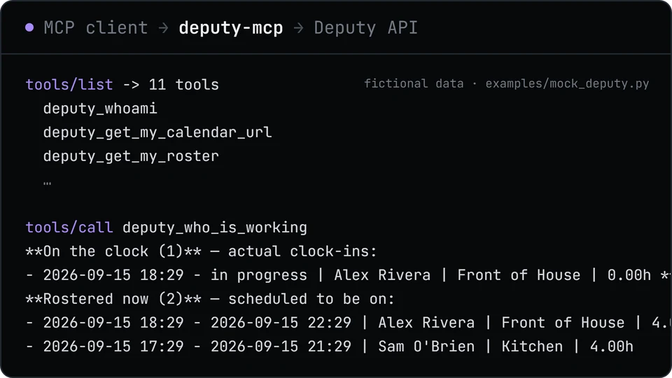
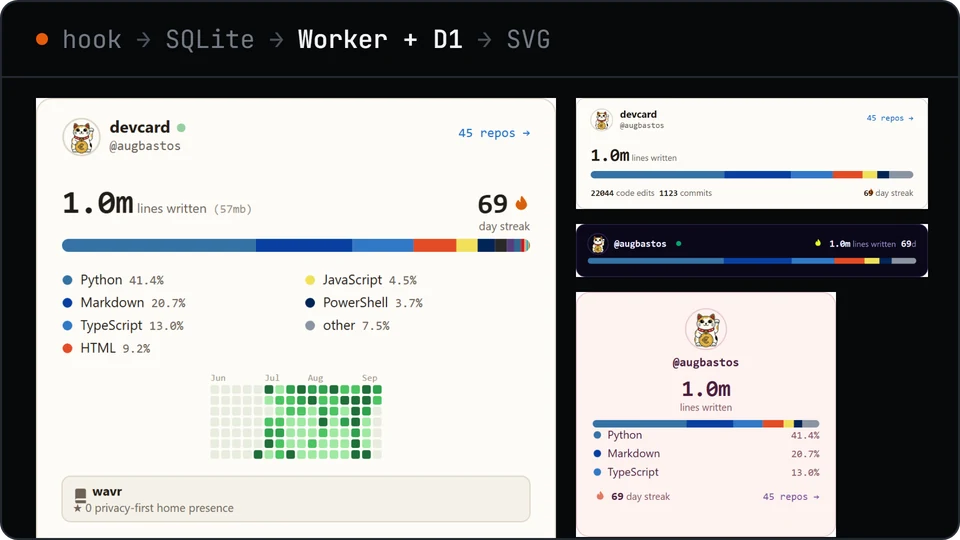
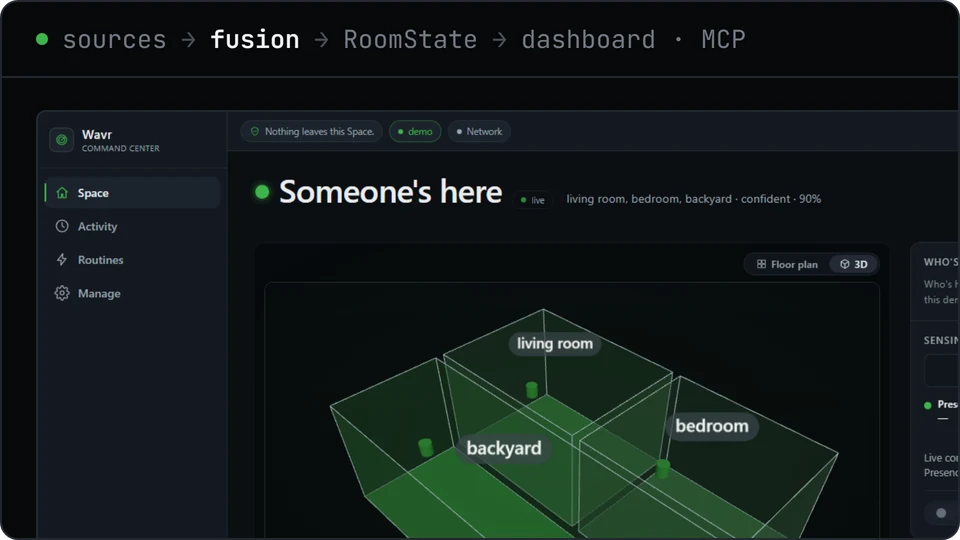
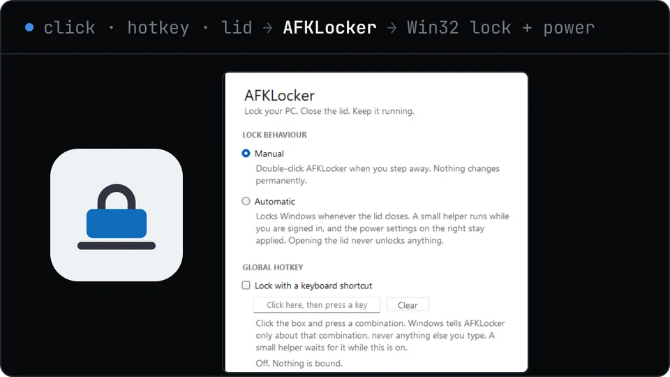

# Augusto Bastos

**Applied AI Engineer.** I build MCP servers, tools for AI coding agents, and local-first software you can run yourself.

Limerick, Ireland · [Portfolio](https://augustobastos.pages.dev) · [LinkedIn](https://www.linkedin.com/in/augustobastos) · [CV](https://augustobastos.pages.dev/cv)

Live from my own coding hooks: lines my agents and I write, rewrites included · powered by <a href="https://github.com/augbastos/devcard">devcard</a>

## Selected work

<table>
<tr>
<td width="50%" valign="top">

 <strong>deputy-mcp</strong>
 Self-hosted MCP server for your Deputy roster and timesheets.
 Python · FastMCP · OAuth 2.0
</td>
<td width="50%" valign="top">

 <strong><a href="https://github.com/augbastos/devcard">devcard</a></strong>
 Live stats card from real AI-assisted coding output.
 TypeScript · Cloudflare Workers · D1
</td>
</tr>
<tr>
<td width="50%" valign="top">

 <strong><a href="https://github.com/augbastos/wavr">Wavr</a></strong>
 Explainable room presence, on hardware you own.
 Python · FastAPI · MCP · AGPL-3.0
</td>
<td width="50%" valign="top">

 <strong><a href="https://github.com/augbastos/AFKLocker">AFKLocker</a></strong>
 Lock the PC, close the lid, keep agents running.
 C# · .NET Framework · Win32
</td>
</tr>
</table>

**Building with** Python · TypeScript · MCP · FastAPI · PostgreSQL · Supabase · Cloudflare Workers · Docker

---

Open to **AI Engineering** and **Applied AI** roles · [Portfolio & CV](https://augustobastos.pages.dev) · [LinkedIn](https://www.linkedin.com/in/augustobastos)
